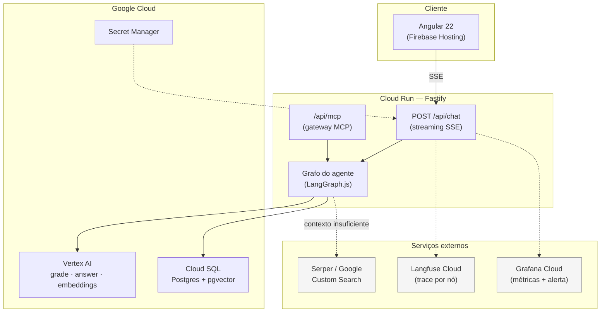
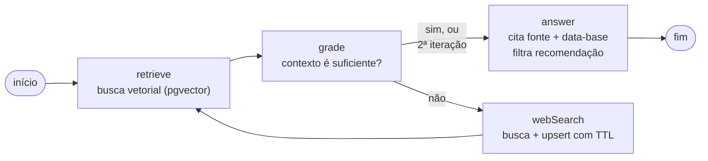
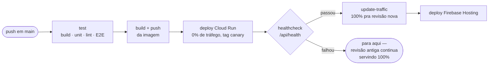

# AI Researcher

Chatbot consultor de investimentos, construído ponta a ponta em vídeo como Capstone da Pós-Graduação em Engenharia AI-Native da UNIPDS.

**Demo:** https://ai-researcher-capstone.web.app
**API:** https://ai-researcher-api-flm3vfx7qq-uc.a.run.app/api/health

> ⚠️ **O sistema informa, nunca recomenda.** A consultoria de valores mobiliários é atividade regulada pela CVM — nenhuma resposta sugere compra, venda ou manutenção de posição. Toda resposta cita a fonte e a data-base do dado. Isso é garantido por código (`packages/agent/src/answer/format-resposta.ts`), não só por instrução de prompt.

## O que é

Consulta uma base vetorial de indicadores financeiros de 20 empresas da B3 (receita, lucro, margem, caixa operacional — direto dos formulários ITR/DFP da CVM), avalia se o contexto recuperado é suficiente pra responder, busca na web quando não é, persiste o enriquecimento pra próxima pergunta e responde sempre citando fonte e período do dado.

O corpus contém só números. Perguntas qualitativas (notícia, guidance, análise de mercado) caem de propósito no fallback de busca web — é assim que o RAG corretivo do projeto se prova.

## Arquitetura

100% Google Cloud, deploy automatizado a cada push em `main`.



### O grafo do agente (RAG corretivo)



`MAX_ITERATIONS = 2` garante que o loop `retrieve → grade → webSearch` nunca roda pra sempre — na segunda passagem, `answer` responde com o que tiver, avisando que o contexto pode estar incompleto.

### Deploy (canary automático)

Todo push em `main` builda, testa e faz deploy sem intervenção manual:



Revisão quebrada nunca chega a servir usuário real. Se uma revisão passar no healthcheck e falhar depois, `pnpm rollback` reverte 100% do tráfego pra revisão anterior num único comando.

## Stack

| Camada | Tecnologia |
|---|---|
| Monorepo | pnpm workspaces + Turborepo |
| API | Fastify + TypeScript |
| Orquestração | LangGraph.js |
| Frontend | Angular 22 (standalone, signals) |
| Banco | Postgres + pgvector (Cloud SQL) |
| LLM e embeddings | Vertex AI via LangChain.js |
| Busca web | Serper / Google Custom Search, atrás de interface |
| Tools | MCP (stdio + Streamable HTTP) |
| Testes | Vitest + Playwright |
| Observabilidade | Langfuse, Prometheus (`/api/metrics`), Grafana Cloud |
| Deploy | Cloud Run + Firebase Hosting, canary automático via GitHub Actions |

## Como rodar localmente

Requer Node 24, pnpm, Docker (Postgres local) e uma conta GCP com Vertex AI habilitado (busca web e LLM continuam sendo chamadas reais mesmo em ambiente local — não há emulador pra esses dois). Ver `infra/README.md` pro provisionamento completo da fundação GCP.

```bash
docker compose up -d          # Postgres + pgvector local, efêmero
pnpm install
pnpm db:migrate
pnpm seed                     # popula o pgvector a partir do corpus versionado
pnpm dev                      # api (:3000) + web (:4200), com proxy local
```

```bash
pnpm test              # unitários (Vitest)
pnpm test:e2e           # ponta a ponta (Playwright)
pnpm lint               # ESLint + Prettier
pnpm capstone:check --url <url>   # audita um deploy de fora, como um cliente veria
```

`DEMO=true` roda o grafo inteiro sem Postgres nem credencial de GCP (fixtures determinísticas) — é o que o CI usa pro E2E.

## Estrutura

```
apps/
  api/            Fastify, rotas, bootstrap
  web/            Angular
packages/
  agent/          grafo, nós, prompts, providers, observabilidade
  mcp-server/     registro das tools (stdio + Streamable HTTP)
  contracts/      schemas zod compartilhados
  corpus/         coleta CVM, normalização, geração de parágrafos
infra/            Dockerfiles, workflow de deploy, provisionamento GCP
scripts/          capstone:check, seed, rollback, alerta, script de carga
```

Regra de dependência: `apps/*` importa `packages/*`; `packages/*` nunca importa `apps/*`.

## Documentação adicional

- [`docs/hero-project-plano.md`](docs/hero-project-plano.md) — ementa, arquitetura completa, checklist de produção
- [`docs/hero-project-tarefas.md`](docs/hero-project-tarefas.md) — quebra de tarefas por bloco, em ordem de dependência
- [`infra/README.md`](infra/README.md) — provisionamento da fundação GCP, valores e decisões
- [`.claude/CLAUDE.md`](.claude/CLAUDE.md) — estado atual do repositório, achados e decisões de cada bloco

## Sobre o curso

Este repositório é material didático da Pós-Graduação em Engenharia AI-Native da UNIPDS — lido linha a linha e explicado em vídeo. O histórico de commits também é conteúdo de aula: cada fase conta a história na ordem em que foi ensinada.
